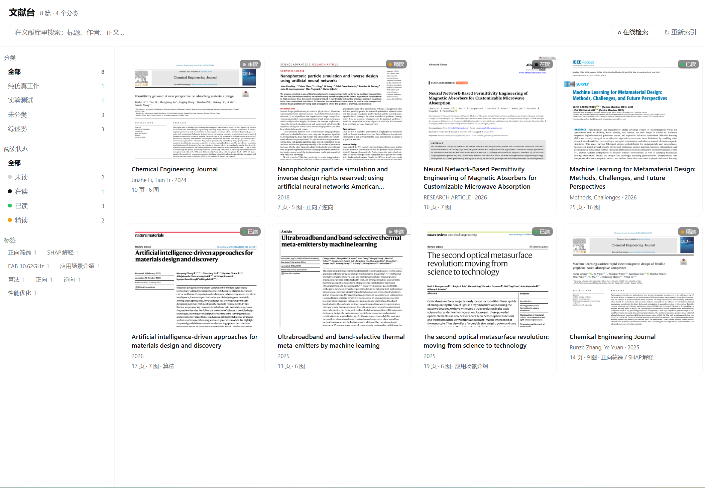
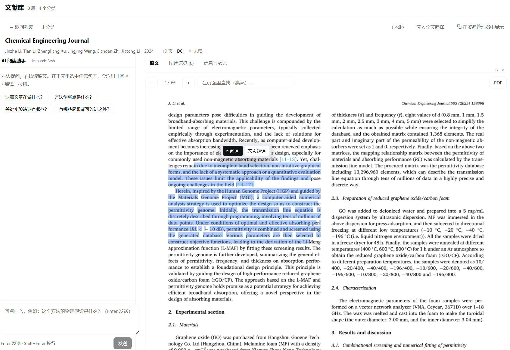
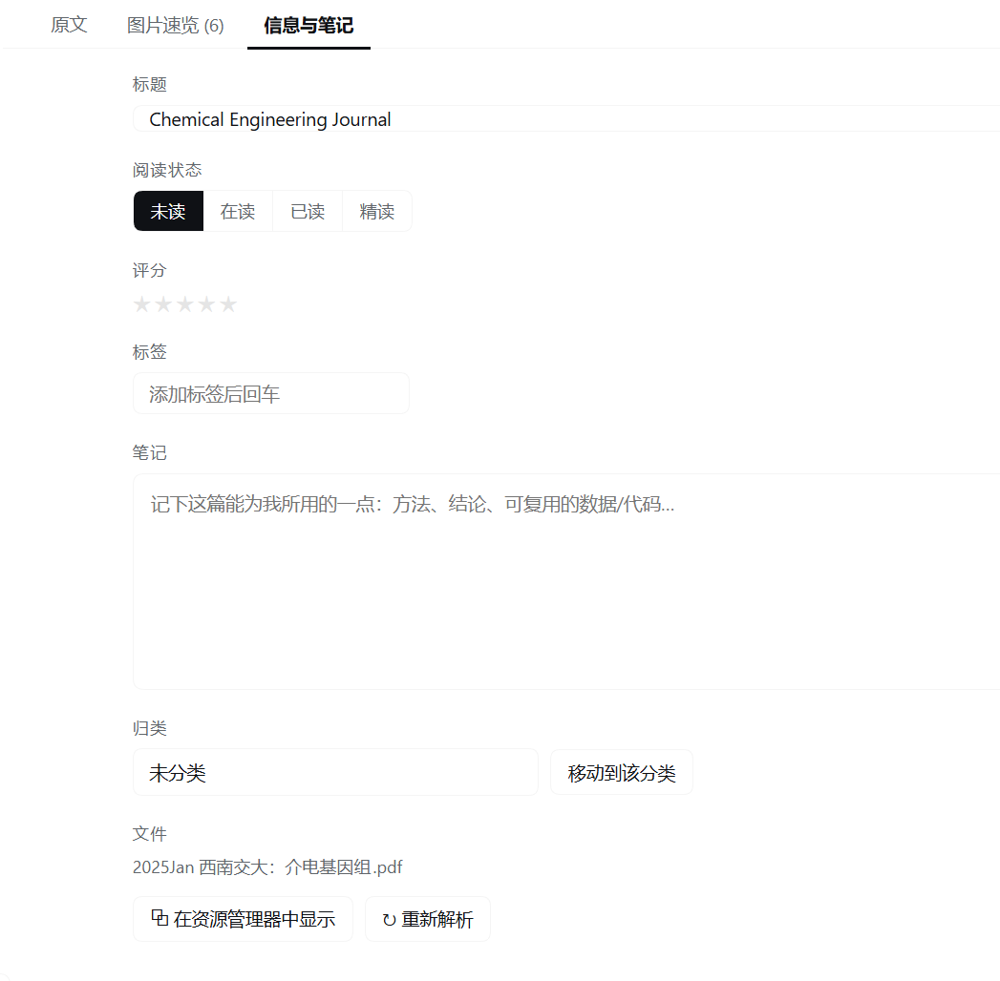

# Paper Harness · 文献台

> A literature workbench for [DeepSeek Harness](https://github.com/deepseek-ai): drop PDFs into a folder
> and read them *with* an LLM — original layout on screen, every sentence selectable, one-click translation.

给 DeepSeek Harness 用的**文献阅读工作台**插件。把 PDF 丢进文献库文件夹，自动建索引；
阅读时**左边问 AI、中间是原文、右边是译文**，原文上任何一句都能直接拖选去提问或翻译。

## 界面

| 文献库 | 原文 · AI · 译文 三栏 |
| --- | --- |
|  |  |

<p align="center">
  
</p>

## 它能做什么

| 能力 | 说明 |
| --- | --- |
| 拖入即索引 | PDF 放进文献库目录（或其下任意分类文件夹）就自动解析：标题、作者、年份、DOI/arXiv、逐页正文、插图、文字坐标 |
| 原文即阅读 | 整页渲染的原文上覆盖一层隐形文字层：版面、公式、插图都在，同时任意句子都能选中、复制、提问 |
| 图片速览 | 自动把每张图**连图注一起裁出来**（矢量图、多面板图、流程图都支持），先看图 30 秒判断这篇值不值得读 |
| AI 陪读 | 三栏并排，选中正文任意一句 → 浮出「问 AI / 翻译」；也能直接对整篇提问（自动带题目、摘要、当前页、正文） |
| 一键翻译 | 选中语段即时翻译；整篇按页流式翻译，**可指定页码区间**（只译第 5–6 页 / 从当前阅读页开始 / 单页补译），逐页落盘、中断可续、一键复制 |
| 整理归类 | 分类（= 文件夹，可直接在资源管理器里整理）、阅读状态、评分、标签、笔记；分类与标签都是筛选维度 |
| 文献检索 | 库内全文检索 + 在线检索（arXiv / Semantic Scholar / Crossref 三源合并），一键下载入库 |
| 给 agent 用 | `paper_library` 工具：检索、读全文与图注、写笔记，让助手直接基于你的文献库干活 |

## 前置要求

- [DeepSeek Harness](https://github.com/deepseek-ai)（桌面端或 Web 端均可）
- Node.js ≥ 22（Harness 自带运行时也行）
- pnpm（推荐）或 npm

## 安装

```bash
git clone https://github.com/baigaobai/dsh-paper-harness.git
cd dsh-paper-harness
pnpm install
```

然后在 Harness 里把这个目录作为 bundle 装上（任选一种）：

**A. 让助手装**（最简单）——对助手说：

> 把 `<你 clone 下来的绝对路径>` 这个 bundle 装进当前 profile

助手会调用 `plugin_manager install_bundle`。

**B. 命令行**：

```bash
dsh plugin --profile <profile> add link:<你 clone 下来的绝对路径>
```

装好后重启 Harness，侧边栏出现「文献台」图标。

> 如果启动时报 `Cannot find native binding`，说明平台预编译包没装上，按你的平台手动补：
> Windows `pnpm add @napi-rs/canvas-win32-x64-msvc`、macOS `@napi-rs/canvas-darwin-arm64`、
> Linux `@napi-rs/canvas-linux-x64-gnu`。

## 快速开始

1. 侧边栏点「文献台」。
2. 把 PDF 拖进文献库目录（默认是仓库下的 `library/`，可在配置里改成任意目录）的分类文件夹。
3. 几秒后卡片出现，点进去开始读。选中正文任意一句 → 问 AI 或翻译。

文献库根目录默认 `<仓库>/library`，也可以在 profile 的 `cordis.patch.yml` 里改：

```yaml
- insert:
    - id: paper-harness
      name: paper-harness
      config:
        libraryRoot: 'D:\papers'   # 文献库根目录
        maxPages: 80               # 每篇最多解析多少页
        pageScale: 1.7             # 阅读视图页面渲染倍率
        figureScale: 2             # 插图裁剪渲染倍率（越大越清晰、越慢）
        maxFigures: 16             # 每篇最多抽多少张图
        watch: true                # 监听目录，拖入即索引
        autoIndex: true            # 启动时自动扫描
```

## 数据放在哪

```
library/
  <分类文件夹>/
    xxx.pdf
  .paper-harness/            # 索引缓存，可删，删了会重建（不影响原 PDF）
    papers/<id>.json         元数据 + 正文 + 文字坐标
    figures/<id>/f1.png      裁出来的插图
    covers/<id>.png          首页缩略图
    pages/<id>/p3@1.70.png   按需渲染的整页图
    translations/<id>.json   译文缓存
```

**不要把 `library/` 提交到仓库**（`.gitignore` 已忽略），里面是你自己的论文。

## 给 agent 用的工具

`paper_library`，`action` 取值：

| action | 用途 |
| --- | --- |
| `state` | 库概况（篇数、分类、标签、状态计数） |
| `list` / `search` | 按分类/状态/标签列出；库内全文检索 |
| `read` | 读一篇：元数据、摘要、图注、正文（`maxChars` 默认 12000） |
| `figures` | 列出插图与图注 |
| `update` | 改阅读状态 / 评分 / 标签 / 笔记 |
| `online` | 在线检索 arXiv / Semantic Scholar / Crossref |
| `import` | 把在线结果或 PDF 链接下载入库 |
| `reindex` | 重新扫描文献库 |

## HTTP API（页面侧，同源）

```
GET  /api/paper-harness/state
GET  /api/paper-harness/papers?q=&category=&status=&tag=
GET  /api/paper-harness/paper/:id
POST /api/paper-harness/paper/:id            {patch:{status,rating,tags,note,title}}
POST /api/paper-harness/paper/:id/reparse
POST /api/paper-harness/reindex
GET  /api/paper-harness/sources?q=&source=all|arxiv|s2|crossref
POST /api/paper-harness/import               {item|url, category}
POST /api/paper-harness/reveal               {id}
GET  /api/paper-harness/file/:id             原始 PDF
GET  /api/paper-harness/cover/:id
GET  /api/paper-harness/fig/:id/:n
GET  /api/paper-harness/page/:id/:n?scale=
POST /api/paper-harness/chat                 {paperId, question, history, focus}   → SSE
POST /api/paper-harness/translate            {paperId, text}                        → SSE
POST /api/paper-harness/translate/paper      {paperId, from, to}                    → SSE（逐页）
GET  /api/paper-harness/translation/:id      已缓存的译文
POST /api/paper-harness/translation/:id/clear
```

## 实现要点

- **解析**：`pdfjs-dist`（文本层 + 页面渲染）+ `@napi-rs/canvas`（离屏光栅化）。
- **解析在独立进程里**（`lib/worker.js`）：pdf.js 与原生 Skia 只在子进程跑，宿主通过 stdin/stdout
  发请求。原生层崩了只杀掉子进程，宿主不受影响。
- **只允许一个 Skia 实例**：pdf.js 自带 `@napi-rs/canvas@0.1.x`，本插件用 `1.1.x`。两个原生模块
  同进程时，互相传递画布 / Path2D 会**直接段错误**（不是异常）。`lib/pdf-core.js` 把进程内所有对该包
  的 require 统一到同一实例，才彻底修掉崩溃。
- **逐页容错**：每渲染一页前上报进度；某页把渲染器搞崩了就重启子进程跳过它，其余页照常索引。
- **可选文字层**：入库时把每个文字对象的坐标一起存下来（`layouts`），前端按百分比铺透明 span，
  所以窗口怎么缩放、页面怎么缩放都对得上。
- **插图定位**：把「文本层之外的非白像素」当图形墨水逐行统计，从图注向上走、跨越子图间隙合并 ——
  对矢量图、多面板图、流程图都有效，不依赖 PDF 内嵌位图。
- **大模型**：调用 Harness 自己的 `llm` 服务，模型取「设置 → 模型」里的默认项，**不需要任何 API Key**。
  每次调用前会解析该模型支持的推理档位并选最低一档，否则整篇翻译会慢一个数量级。

## 已知边界

- 扫描版（无文本层）PDF：页面照常显示，但没有可选中文字，也提取不到正文。
- 极少数页面会让渲染器崩溃（Skia 的坑）：该页显示占位提示，不影响整篇索引。
- 图注不规范的文献可能裁不到图：可直接看原文页面。
- 在线检索受各站点限流影响；Crossref 多数条目没有开放 PDF，只有元数据。
- 目前以 Windows + DeepSeek Harness 桌面端为主要验证环境。

## 隐私

- 所有文献、索引、译文都只存在你本机的 `library/` 目录里，不会上传任何服务器。
- 只有「问 AI / 翻译」时，才会把你选中的那段文字和论文上下文发给当前配置的模型服务。

## License

[MIT](LICENSE) © baigaobai

---

欢迎提 Issue / PR。想加的功能（Zotero 导入、生词本、多篇对比……）比较有意思的话，可以先开 Issue 聊聊。
